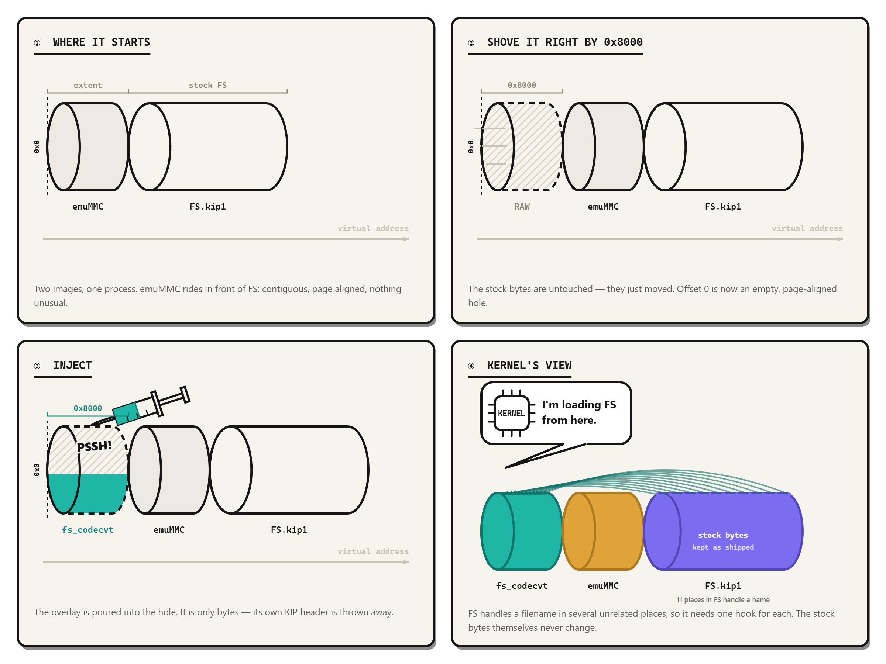

# nx-fs-utf8

> **Branch note (`codex/exfat`):** this branch builds an exFAT-only regression
> candidate using the original six-slot `PF_CHARCODE` replacement strategy.
> It intentionally does not match the FAT32-only FS image. The generated KIP
> still requires hardware regression testing before release.

`nx-fs-utf8` makes UTF-8 filenames work in the Nintendo Switch FS sysmodule.
On-disk names stay standard UTF-16 long filenames, so a card written by the
Switch is readable on Windows, macOS and Linux without any sidecar file or
helper tool.

It is delivered as a small **FS Overlay KIP**: an image prepended *inside* the
existing FS process by an FS-Overlay-aware Fusee or Hekate.

> **Support status: emuMMC only.** The overlay is currently verified on emuMMC.
> **sysMMC (emuMMC disabled) is not supported yet** — every attempt to prepend
> the image there has ended in a black screen before FS starts, and the cause is
> not yet understood well enough to work around. Treat a sysMMC boot with
> `fsoverlay=` set as non-functional, not merely untested.

> **Important:** the overlay is *not* a standalone Initial Process KIP. Do not
> load it with Hekate's `kip1=` key. It deliberately reuses the FS Program ID
> (`0100000000000000`) and must be merged into the existing `FS.kip1` process
> image by an FS-Overlay-aware loader.

## What the patch does

FS is one module containing several stacked implementations. Only two of them
decide whether a non-ASCII filename survives, and this project edits exactly
those two — plus the path handling that feeds them.

```text
application (libnx fsdev, UTF-8 path bytes)
      │
      ▼
L0  nn::fssrv            IPC server          unchanged
L1  nn::fs / fssystem    accessors, saves    unchanged
L2  nn::fat              SFAT wrapper        ← gate 2: name scan
L3  nn::e::prfile2       FAT engine          ← gate 1: codec
L4  nn::sdmmc / nn::gc   media drivers       unchanged
```

### How the overlay gets to write into FS

FS's `.text` is mapped read-execute. Before any hook is installed, the overlay:

1. **Locates FS.** `svcQueryMemory` on the page-aligned address just past its
   own image gives the RX region that contains FS (and emuMMC, when enabled).
   It then walks that region page by page and accepts the first base whose
   bytes match a supported profile — six codec entry signatures, the four
   high-level entry points, the directory-scan branch, and a handful of
   identity opcodes. No match means no hooks, and stock FS boots untouched.
2. **Obtains a handle to itself.** It creates a session with
   `svcCreateSession` and reads the process handle the kernel places in the
   reply TLS.
3. **Maps FS writable.** `svcMapProcessMemory` puts an alias of FS's RX pages
   at a scratch address, which is what makes the writes possible. This is the
   same privileged call emuMMC uses, which is why the merged KIP needs
   emuMMC's capability set even on a sysMMC-only boot.
4. **Writes, then flushes.** `armDCacheFlush` + `armICacheInvalidate`, then the
   writable alias is released.

### What gets written

Fourteen instructions are overwritten: eleven branches into the overlay, and
three `NOP`s.

| Site | Count | Replaced with |
|---|---|---|
| `PF_CHARCODE` six entries | 6 | branch to the UTF-8 codec pair |
| path / pattern / short-name entries | 4 | branch to full-string converters |
| `Directory::Read`, mid-function | 1 | branch to a trampoline in a NOP hole |
| three ASCII folding points | 3 | `NOP` |

The directory hook is the awkward one: it sits inside a function rather than at
its entry, so the trampoline saves every live register, calls the C++ validator,
and branches back to one of three places depending on the answer — reject,
continue with the ASCII checks, or continue scanning. `X8` is deliberately left
free because it carries the next scan index back out.

Two consequences worth stating explicitly:

- **Code has no relocation entries.** FS's own relocation pass rewrites pointers
  in `.data` at startup; it cannot touch `.text`. A branch written into code
  survives, which is why this works at all when the overlay runs before FS.
- **Nothing is moved.** The trampoline lives in a stretch of existing NOP
  padding (`cave` in the offset table), so section offsets are unchanged and no
  space has to be reclaimed.

Known limit: only the BMP is covered (no 4-byte UTF-8 / emoji), and on FAT32
the legacy 8.3 alias remains lossy because the short-name generator is not
replaced.

## FS.kip1 is six layers

FS looks like one sysmodule but is several implementations linked into one
process image. The split below is what the two gates have to be understood
against.

| # | Namespace | Role | On the filename path |
|---|---|---|---|
| L0 | `nn::fssrv` | IPC server, 10 CMIF interfaces | yes |
| L1 | `nn::fs` + `nn::fssystem` | accessors, save stack, storage decorators | yes |
| L2 | `nn::fat` | SFAT wrapper: `FatFileSystem`, name validation | yes — **gate 2** |
| L3 | `nn::e::prfile2` | FAT engine, `PF_CHARCODE` codec | yes — **gate 1** |
| L4 | `nn::sdmmc` / `nn::gc` | SD, eMMC, GameCard drivers | yes |
| L5 | `nn::sf`, `os`, `rtld`, `crypto`, `nlibsdk`, `diag` | platform runtime, linked into the same KIP | no |

L5 is not on the path, but it is not optional either: `nn::rtld` is what
applies `R_AARCH64_RELATIVE`, and without resolving those relocations virtually
every vtable and pointer table in `.data` reads as zero.

### The two gates

| Gate | Layer | Decides | If only the other gate is fixed |
|---|---|---|---|
| 1 | L3 `PF_CHARCODE` | UTF-16 ↔ disk bytes | names are written, but the directory listing stays empty |
| 2 | L2 name scan | whether those bytes may be enumerated | nothing is ever written in the first place |

Both must be handled. This is the single most common misunderstanding about
the whole problem, and it is why "just fix the codec" never worked.

## Why this project calls it an Overlay

We are aware that the word is not an Atmosphère term, and that calling this an
"Overlay" has been contested. We keep it, but not as a claim about anyone's
terminology — because the mechanism is not a rename of something that already
had a name, and because it turns out to have a property worth naming. The
distinction is:

```text
Standalone KIP:  creates another Initial Process
FS Overlay KIP:  becomes a prefix inside the existing FS process image
```



In one line: the stock image is never edited. It is pushed to a higher address
and the freed page-aligned hole at offset 0 is filled.

### The property: the hash is checked before the injection

> **The short version.** The loader asks "which FS is this?" *before* we touch
> anything, and never asks again afterwards. So `nogc`, `emuMMC` and
> `patches.ini` all still see the stock build and keep working, while the code
> that actually runs is ours.

Both loaders identify FS by SHA-256 and then apply version-specific patches —
`nogc`, `emuMMC`, `patches.ini`. The order of those two steps is what matters.

```text
Fusee  fusee_stratosphere.cpp
  ConfigureStratosphere()
    AddInitialProcess(nn_fs_kip)   hash = SHA-256 of the stock FS KIP
    GetFsVersion(kip_hash)         known -> the nogc offset table is usable
  RebuildPackage2()
    dst = copy(meta->kip)          injection edits this copy only
    ...overlay at offset 0, sections shifted...

Hekate  bootloader/hos/hos.c
  ① pkg2_patch_kips()
  ② hash compare + patches.ini
  ③ pkg2_inject_fs_overlay()       overlay happens HERE, after hashing
```

An overlay is injected *after* that identification step, so at the moment the
hash is taken the image is still the pristine stock KIP. That is what keeps
these working:

| Still applied | Because |
|---|---|
| hekate `nogc` | its offsets are selected from the recognised FS hash |
| hekate `emuMMC` | same identification path |
| `patches.ini` / `.ips` entries | keyed on the same hash |
| fusee `GetFsVersion` | never reaches the unknown-hash fatal path |

So the overlay does not need to keep FS's hash intact — it needs only to not be
present yet when the hash is computed. FS continues to look like the stock
build to every loader-side decision, while the code that actually runs carries
the patch.

The overlay also fails *closed*: it verifies the FS build by instruction
signatures before installing anything, so an unsupported FS runs unmodified
instead of half-patched.

The exFAT branch contains profiles for the exFAT-capable FS variants used by
HOS 19.0.1, 20.2.0, 21.2.0, 22.0.0, and 22.5.0. It does not contain the
FAT32-only FS profile. Do not infer cross-version exFAT validation from the
earlier FAT32-media regression results.

## Requirements

- devkitPro with devkitA64 and libnx
- GNU Make
- Python 3.9 or newer

The repository contains its own uncompressed ELF-to-KIP1 packer. Atmosphère,
`elf2kip`, and `hactool` source trees are not required to build it.

## Build

```sh
export DEVKITPRO=/opt/devkitpro
make -j4
```

The build produces:

```text
fs_codecvt_exfat.elf
fs_codecvt_exfat_unpacked.kip
```

The unpacked KIP is the deployable FS Overlay. Its loadable sections are stored
without BLZ compression because both supported loaders require an unpacked
overlay image.

Clean generated files with:

```sh
make clean
```

## Test program

[`test_program`](test_program) contains the libnx homebrew program used to
verify CJK filename round trips on hardware. It creates and reads
`sdmc:/ROM/中文目录/往返测试.txt`, then verifies that both Chinese names appear
through directory enumeration. This test client is separate from the Overlay
KIP and is launched through the Homebrew Menu.

Build it with devkitPro:

```sh
cd test_program
./build.sh
```

See [`test_program/README.md`](test_program/README.md) for Windows build steps,
controls, expected results, and the SD-card write warning.

## Deployment

> **The deployment target is emuMMC.** sysMMC is not supported by this
> mechanism yet — see [Limitations](#limitations).

The KIP must be loaded through the FS Overlay mechanism. For Hekate, use only
the fork-specific `fsoverlay=` key shown below; `kip1=` is not compatible with
the overlay build and must not point to `fs_codecvt_exfat_unpacked.kip`.

Fusee-compatible layout:

```text
sdmc:/atmosphere/fs_overlays/fs_codecvt_exfat_unpacked.kip
```

Hekate Fork boot entry:

```ini
pkg3=atmosphere/package3
fsoverlay=atmosphere/fs_overlays/fs_codecvt_exfat_unpacked.kip
```

When emuMMC is enabled in the Hekate path, use the relocatable emuMMC build
that derives its text base from `_start`.

The merged FS process image is arranged from lower to higher virtual addresses:

```text
increasing virtual address ─────────────────────────────────────────────►

+----------------------+------------------------+--------------------------+
| fs_codecvt overlay   | emuMMC KIP             | original FS.kip1         |
| begins at offset 0   | only when emuMMC is on | every section shifted    |
+----------------------+------------------------+--------------------------+
|<---- 0x8000 -------->|<--- emuMMC extent ---->|
```

Both values are offsets inside the merged `.text` region, not absolute
addresses. Everything the original FS owns — `.rodata`, `.data`, `.bss`, and
the virtual addresses recorded in its section headers — moves up by the same
total.

The emuMMC KIP is not an optional decoration here: it is what sets up the
process memory permissions before control reaches FS. That is why the supported
configuration is the one where it is present.

## Limitations

| Scope | Status |
|---|---|
| emuMMC | verified on hardware |
| sysMMC (emuMMC disabled) | **not supported** |
| 4-byte UTF-8 (non-BMP, e.g. emoji) | not covered |
| FAT32 8.3 alias | lossy; the short-name generator is not replaced |

### sysMMC

Every configuration tried so far — varying the memory extent, the section
layout, the capability set, whether `.text` stays compressed, and even an
overlay that only jumps straight back into the stock entry point — has produced
a black screen before FS starts. Because even a pass-through overlay fails, the
problem is in prepending itself on that path, not in this project's hooks.

We do not have a mechanism for it. Do not report sysMMC results as working,
and do not enable `fsoverlay=` on a sysMMC-only setup.

## Safety

This project patches the FS process at runtime. Back up important storage before
testing a new firmware or FS variant.

The overlay fails closed: it identifies the FS build by instruction signatures
before installing anything, and an unsupported build simply runs unmodified.
That protects against an unrecognised firmware version; it does not protect
against booting on an unsupported configuration, which is what the sysMMC case
above is.

## License and credits

Copyright (c) 2026 slankka and contributors.

This project is licensed under the GNU General Public License version 2 only
(`GPL-2.0-only`). See [LICENSE](LICENSE).

The KIP startup/runtime framework is derived from the Atmosphère emuMMC design.
Copyright and attribution for upstream-derived portions remain with m4xw and
Atmosphere-NX. UTF-8 codec conversion, FS discovery, validation, and hook logic
are maintained by the `nx-fs-utf8` project.

Development was assisted by generative AI. The maintainer directed, reviewed,
modified, tested, and approved the resulting code. The AI tool is not an author
or copyright holder.
